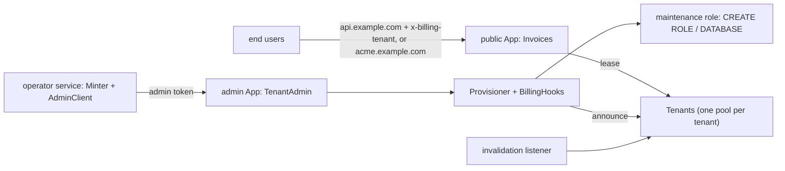

# Example: tenants

A neutral product, `billing`, that serves many tenants from one process,
each on a Postgres database and a role of its own, built on
[`sekvent::tenancy`](../../docs/modules/tenancy.md) (design note:
[tenancy.md](../../docs/design/tenancy.md)). It shows the serving half (the
tenant resolver, the tenant cache, the invalidation listener), the
lifecycle (provisioning with the product's hooks, suspend, resume, purge,
usage) and the admin surface (the product's own admin service, admin
tokens, the guard), called by an operator service through the manager kit.

## Crates

| Crate | What it holds |
|---|---|
| `billing-api` | `billing.invoices.v1`: the public `Invoices` service (`CreateInvoice`, `ListInvoices`), the trait and `InvoicesError`. `billing.admin.v1`: the product's own `TenantAdmin` service (`ProvisionTenant`, `SuspendTenant`, `ResumeTenant`, `PurgeTenant`, `GetTenant`) and its trait; `ops` names each RPC as admin tokens do |
| `billing` | `BillingScope` (the tenant's pool) and its `ScopeFactory`; `BillingHooks` (`TenantHooks`): the seed creates the default invoice series and an owner invitation whose token is handed over once, `usage` counts invoices, `describe` names the tenant; the tenant migrations (`migrations/tenant`) and the control migration (`migrations/control`, a copy of `control::REFERENCE_SCHEMA`, checked by a unit test); `InvoicesService` and `TenantAdminService` |
| `billing-svc` | `BillingConfig` (its `BILLING_*` keys), `Billing` (two Apps on one runtime, the units), a thin `main.rs`, and the Docker test |

sekvent ships no admin service. The product declares `TenantAdmin` in its
own proto with the RPCs it wants, and wraps each body in
`admin::guard::run`, which checks that the call's admin token was minted
for this RPC and this tenant and records the token id before the body runs,
so a token is usable once.

## How the service is put together



- **The public App** (unit `components`, listener `public-grpc`) serves
  `Invoices` over gRPC and gRPC-Web. Its scope resolver is a
  `TenantResolver`: on the shared API host (`BILLING_API_HOST`) the request
  names its tenant by id in `x-billing-tenant`; on any other host the host
  is looked up as a tenant's own (`acme.example.com`). The handler reads the
  tenant's pool from the `TenantLease` in its scope. The component is served
  without end-user authentication (`SERVE_AUTH=none`) to keep the example
  about tenancy; a product registers its end-user authenticator here.
- **The admin App** (unit `admin-components`, listener `admin-grpc`) serves
  `TenantAdmin` with `SERVE_AUTH=bearer`. Its one end-user authenticator is
  `admin::authenticator`: EdDSA tokens of the operator service's keys,
  60 seconds, minted for one RPC and at most one tenant, subjects
  `operator:<name>`. Keep its listener off the public network.
- **The tenant cache** (`tenants`) and **the invalidation listener**
  (`tenant-changes`) run in `Stage::Infrastructure`. The provisioner
  announces every committed change on this process before the call returns
  and on the channel for the others, so a suspended tenant stops being
  served everywhere.
- The two Apps' `SEKVENT_COMPONENT_*` settings are fixed in code: each App
  checks the keys under that prefix against its own components, so two
  Apps reading one environment would refuse each other's keys.

At startup the service migrates the control database with
`CONTROL_MIGRATOR` (as the role that owns it) and checks it with
`control::verify_schema`. Every tenant database is migrated with
`TENANT_MIGRATOR` as the tenant's own role, when the provisioner creates it
and whenever the cache opens it.

## Configuration

| Key | Default | Meaning |
|---|---|---|
| `BILLING_PUBLIC_ADDR` | `127.0.0.1:8080` | the public listener |
| `BILLING_ADMIN_ADDR` | `127.0.0.1:8081` | the admin listener |
| `BILLING_CONTROL_URL` | required, secret | the control database as its owner |
| `BILLING_CONTROL_MAX_CONNECTIONS` | `8` | the control pool, at least 3 |
| `BILLING_MAINTENANCE_URL` | required, secret | the maintenance role (`LOGIN CREATEDB CREATEROLE`, not a superuser) on its database; also the host where tenant databases are opened |
| `BILLING_ROLE_SECRETS` | required, secret | `key_id:secret[,…]`, the master secrets tenant role passwords are derived from (at least 32 bytes each) |
| `BILLING_ROLE_KEY_ID` | required | the key id new tenants are derived under |
| `BILLING_OBJECT_PREFIX` | `app_t_` | the prefix of every tenant role and database |
| `BILLING_CHANNEL` | `billing_changes` | the invalidation channel |
| `BILLING_API_HOST` | `api.example.com` | the shared API host |
| `BILLING_TENANT_CAPACITY` | `64` | tenants held open at once |
| `BILLING_TENANT_CAP` | `1000` | tenants that are not purged |
| `BILLING_TENANT_CONNECTION_LIMIT` | `20` | each tenant role's connection limit |
| `BILLING_ADMIN_ISSUER` | required | the operator service's token issuer |
| `BILLING_ADMIN_AUDIENCE` | required | this instance's name in admin tokens |
| `BILLING_ADMIN_KEYS` | required | the operator's public keys, `key_id:<base64url Ed25519 key>[,…]` (what `Minter::public_key_entry` prints) |

## The operator's side

An operator service holds the Ed25519 signing key and calls the admin API
with the manager kit; each call mints a fresh token for that one RPC:

```rust
let minter = Minter::new("operator-console", signing_key, Arc::new(SystemClock));
let client = AdminClient::new("https://billing-admin.example.com", "billing-eu", minter)?;
let reply: ProvisionTenantReply = client
    .call(ops::PROVISION_TENANT, Some(tenant), "operator:ada", &NoExtra {}, deadline, &request)
    .await
    .into_result()?;
```

`CallOutcome` tells `NotSent` (safe to try again), `Refused` (the product
decided) and `Unknown` (read the tenant back with `GetTenant`; repeat only
an operation that converges, as `ProvisionTenant` does). The owner token in
the reply comes only from the call that ran the seed; a repeat says it is
withheld.

## Contracts

[`sekvent.toml`](sekvent.toml) lists `billing-api/proto` under `[contract]`;
the baselines of both services live in `contracts/`:

```sh
cd examples/tenants
cargo sekvent contract check        # compare the protos with the baselines
cargo sekvent contract emit         # rewrite the baselines after a compatible change
```

## Tests

```sh
SEKVENT_DOCKER_TESTS=1 cargo test -p billing-svc -- --include-ignored
```

`billing-svc/tests/provision.rs` starts a Postgres container (skipped
unless `SEKVENT_DOCKER_TESTS=1`), sets up a cluster the way production would
have it (a maintenance role that is not a superuser, a separate owner of the
control database, `CONNECT` and `TEMPORARY` revoked from `PUBLIC`), builds
the service on it with both listeners on `127.0.0.1:0`, then:

1. provisions a tenant through `AdminClient` and `ProvisionTenant`, and
   gets the owner token once (a repeat converges and withholds it);
2. issues two invoices and lists them through `Invoices` on the shared API
   host with the tenant header, over gRPC-Web;
3. reads the usage with `GetTenant`, suspends the tenant, and sees the next
   call refused with `FAILED_PRECONDITION`.

The unit tests of `billing` and `billing-svc` need no server.
